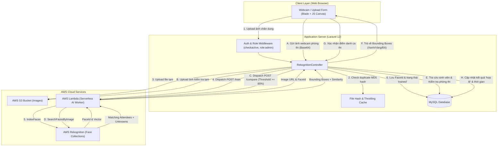
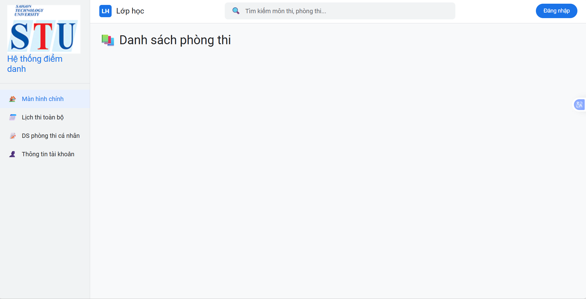
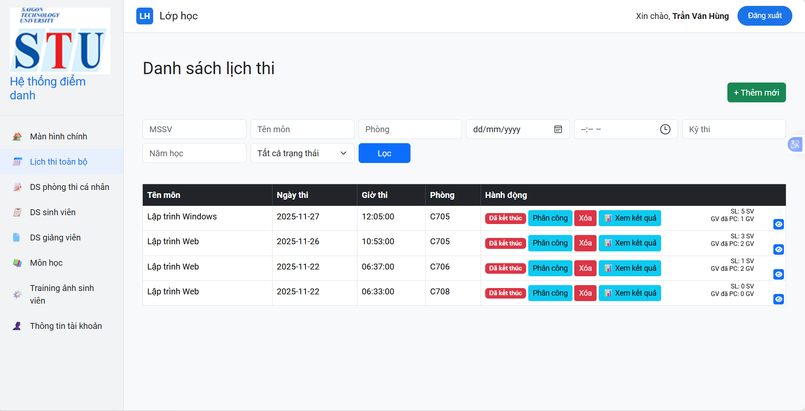
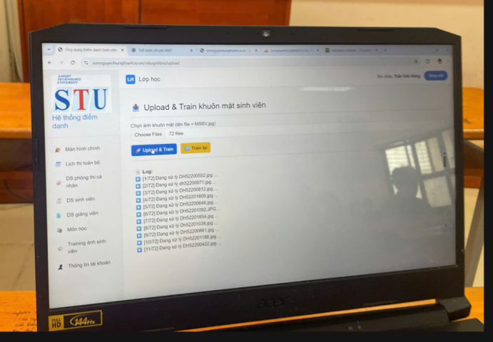
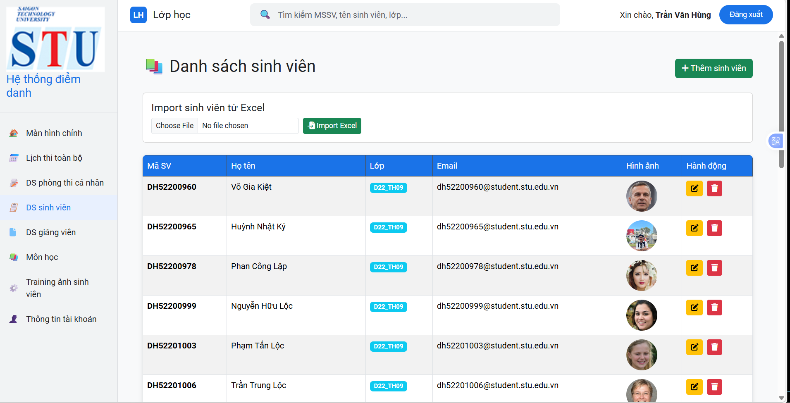
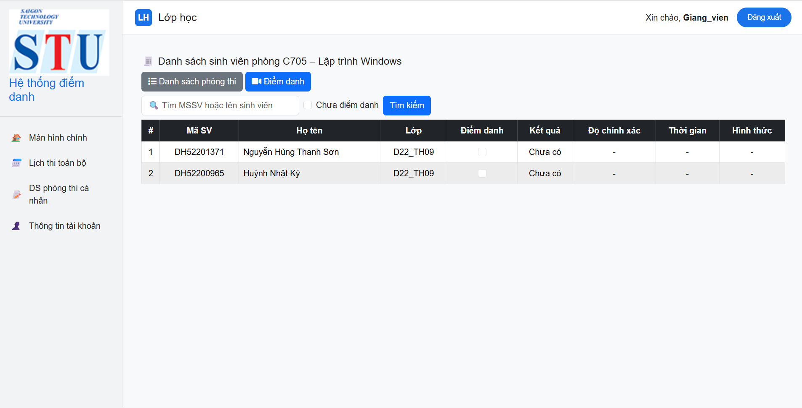
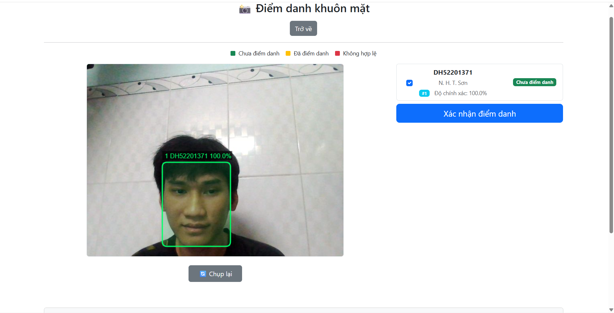
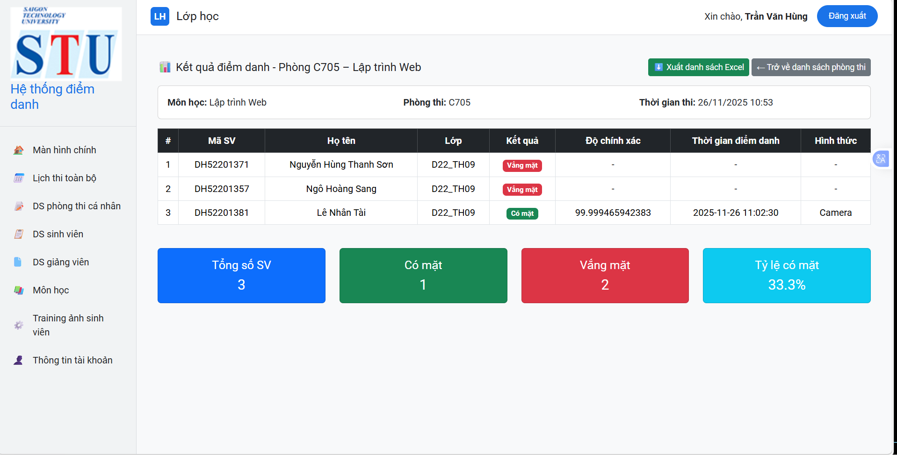

<div align="center">

# 🎓 Face Recognition Exam Attendance System
### Hệ thống Điểm danh Phòng thi bằng Nhận diện Khuôn mặt

[](https://www.php.net/)
[](https://laravel.com/)
[](https://aws.amazon.com/rekognition/)
[](https://aws.amazon.com/lambda/)
[](https://aws.amazon.com/s3/)
[-brightgreen?style=for-the-badge&logo=phpunit&logoColor=white)](https://phpunit.de/)
[](https://www.mysql.com/)
[](LICENSE)

<br/>

[📋 Tính Năng](#-tính-năng-chính) • [🏗️ Kiến Trúc Hệ Thống](#%EF%B8%8F-kiến-trúc-hệ-thống--luồng-hoạt-động) • [🌟 Điểm Nổi Bật Kỹ Thuật](#-điểm-nổi-bật-về-mặt-kỹ-thuật) • [🧪 Kiểm Thử (Tests)](#-kiểm-thử-tự-động-automated-testing) • [⚙️ Cài Đặt](#%EF%B8%8F-hướng-dẫn-cài-đặt-local)

</div>

---

## 📌 Giới thiệu dự án (Overview)

Trong các kỳ thi tập trung tại trường đại học, quy trình điểm danh truyền thống (gọi tên thủ công, đối chiếu thẻ sinh viên) thường mất từ **15 - 20 phút mỗi ca thi**, tiềm ẩn rủi ro **gian lận, thi hộ, hoặc sinh viên vào nhầm phòng thi**.

**Face Recognition Attendance System** là giải pháp phần mềm toàn diện kết hợp **Laravel 12** và **hạ tầng Cloud Serverless của AWS (Rekognition, Lambda, S3)** nhằm:
- ⚡ **Rút ngắn thời gian điểm danh**: Nhận diện đồng thời nhiều sinh viên trong một khung hình/ảnh chụp chỉ trong **vài giây**.
- 🛡️ **Ngăn chặn thi hộ & gian lận**: Độ tương đồng khuôn mặt được so khớp qua vector embedding trên AWS Rekognition với ngưỡng tin cậy cao (**Threshold >= 85%**).
- 🔍 **Cảnh báo đi nhầm phòng thi theo thời gian thực**: Tự động tra cứu lịch thi trong ngày khi phát hiện sinh viên không thuộc danh sách phòng thi hiện tại.
- ⏱️ **Tự động hóa quản trị phòng thi**: Chống trùng lịch phân công giám thị, tự động chuyển trạng thái "Vắng mặt" cho sinh viên khi kết thúc ca thi.

---

## 🌟 Điểm nổi bật về mặt Kỹ thuật (Technical Highlights)

Dự án được xây dựng theo chuẩn công nghiệp (Production-ready mindset) với các điểm sáng kỹ thuật:

1. **Kiến trúc Cloud-Native & Serverless Decoupling**:
   - Sử dụng **AWS Lambda** làm lớp trung gian xử lý AI (Serverless Microservices) thay vì gọi trực tiếp từ web server. Giúp tách biệt hoàn toàn ứng dụng web với tác vụ nặng về xử lý ảnh/AI, đảm bảo Laravel core luôn nhẹ, phản hồi nhanh và mở rộng linh hoạt (Elastic Scalability).
   - Lưu trữ và phân phối hình ảnh sinh viên an toàn qua **AWS S3** với URL ký tự động và vòng đời dọn dẹp ảnh tạm.

2. **Nhận diện đồng thời nhiều khuôn mặt (Multi-Face Batch Attendance)**:
   - Module `compareMany` hỗ trợ phát hiện và nhận dạng nhiều khuôn mặt cùng lúc từ webcam hoặc hình ảnh phòng thi.
   - Hệ thống bounding boxes thông minh được gán trực tiếp lên ảnh với quy ước trực quan:
     - 🟩 **Xanh lá**: Sinh viên hợp lệ trong phòng thi, chưa điểm danh -> Có thể xác nhận 1-click.
     - 🟨 **Vàng**: Sinh viên đã được điểm danh trước đó trong ca thi.
     - 🟥 **Đỏ**: Khuôn mặt lạ / không đạt chuẩn nhận diện / sinh viên không thuộc ca thi.

3. **Thuật toán kiểm soát chất lượng ảnh đầu vào (Quality Pre-checks)**:
   - Trước khi nhận diện, hệ thống phân tích các chỉ số chất lượng: **độ nét (sharpness)**, **độ sáng (brightness)**, kích thước pixel của khuôn mặt, **góc quay ngang (yaw)** và **góc cúi/ngửa (pitch)** để đảm bảo độ tin cậy và ghi log cảnh báo chi tiết.

4. **Kiểm tra chéo phòng thi & Chống nhầm lẫn lịch thi (Cross-Schedule Check)**:
   - Khi một sinh viên quét mặt tại phòng thi nhưng không có tên trong danh sách ca hiện tại, hệ thống không chỉ báo lỗi đơn thuần mà tự động truy vấn các ca thi khác trong cùng ngày của sinh viên đó và hiển thị ngay thông báo: `⚠️ [MSSV] - [Họ tên] không thuộc phòng này. 👉 Lịch trong ngày: [Tên môn] - [Phòng] - [Giờ thi]`.

5. **Logic phân công giám thị không xung đột (Conflict-Free Proctor Scheduling)**:
   - Tự động chặn phân công nếu giảng viên đang bị khóa tài khoản hoặc đã được xếp lịch gác thi trùng khung giờ ở phòng thi khác.
   - Chặn hành động xóa/thay đổi phân công khi ca thi đang diễn ra.

6. **Chống trùng lặp & Dọn dẹp dữ liệu thông minh**:
   - Mã hóa `file_hash` (MD5) kiểm tra trùng lặp ảnh khuôn mặt trước khi đẩy lên cloud.
   - Throttling cache 30 phút tự động dọn dẹp các bản ghi train ảnh bị lỗi (`cleanupFailedSafe`).

7. **Bộ kiểm thử tự động toàn diện (139 Tests - 314 Assertions)**:
   - Đạt 100% test pass từ **Unit Test** (Models, Scopes, Accessors, Relations, Mail) đến **Feature Test** (Authentication, RBAC Middleware, Lịch thi, Phân công, Mock HTTP Lambda & AWS Rekognition).

---

## 🏗️ Kiến trúc Hệ thống & Luồng hoạt động



---


## 🛠️ Công nghệ sử dụng (Tech Stack)

| Lĩnh vực | Công nghệ / Thư viện | Vai trò |
| :--- | :--- | :--- |
| **Backend Framework** | **PHP 8.2+ / Laravel 12.x** | Core MVC, Routing, Multi-guard Auth, Eloquent ORM, Model Observers |
| **Cloud & AI Engine** | **AWS Rekognition** | Nhận dạng khuôn mặt, Indexing vector, Face Collection, Similarity Matching |
| **Serverless Compute** | **AWS Lambda** | Microservice xử lý trung gian tác vụ trích xuất và so khớp khuôn mặt |
| **Cloud Storage** | **AWS S3 (`flysystem-aws-s3-v3`)** | Lưu trữ ảnh chân dung sinh viên và ảnh chụp phòng thi |
| **Cơ sở dữ liệu** | **MySQL 8.0** | Lưu trữ dữ liệu nghiệp vụ, quan hệ bảng chặt chẽ, foreign keys & indexes |
| **Frontend** | **Blade, Bootstrap 5, JavaScript (ES6)** | Giao diện Responsive, Webcam streaming API, Canvas Bounding Box |
| **Xử lý tài liệu & ảnh** | **Intervention Image, Maatwebsite Excel** | Xử lý format ảnh, Import/Export danh sách sinh viên & ca thi |
| **Kiểm thử tự động** | **PHPUnit 11** | Unit Testing, Feature Testing, Mocking HTTP calls & AWS Services |

---

## ⚡ Tính năng Chính (Features Breakdown)

### 1. Phân hệ Quản trị viên (Admin)
- **Quản lý dữ liệu học vụ**: Quản lý sinh viên, giảng viên, môn học, phòng thi, ca thi (CRUD hoàn chỉnh).
- **Nhập/Xuất Excel hàng loạt**:
  - Tải file mẫu chuẩn Excel.
  - Import danh sách sinh viên, giảng viên, môn học tự động kiểm tra tính hợp lệ dữ liệu.
  - Export danh sách kết quả điểm danh ca thi ra file Excel.
- **Quản lý & Huấn luyện khuôn mặt (Face Training)**:
  - Tải lên ảnh chân dung sinh viên, kiểm tra độ trùng lặp qua hash MD5.
  - Giới hạn tối đa 2 ảnh/sinh viên để tối ưu độ chính xác và chi phí vector AWS.
  - Quản lý, xem lại và xóa ảnh train trực tiếp khỏi Rekognition Collection.
- **Quản lý & Phân công lịch thi**:
  - Xếp lịch thi theo môn, phòng, ngày, giờ và thời lượng.
  - Thêm / bớt sinh viên vào phòng thi.
  - Thuật toán phân công giám thị gác thi có cơ chế chống trùng giờ thi.
  - Thống kê tình trạng ca thi: *Chưa diễn ra*, *Đang diễn ra*, *Đã kết thúc*.

### 2. Phân hệ Giảng viên / Giám thị phòng thi
- **Điểm danh thời gian thực qua Camera/Ảnh**:
  - Mở webcam trực tiếp trong phòng thi hoặc chụp ảnh tải lên.
  - Hệ thống tự động phát hiện tất cả các khuôn mặt trong ảnh, gửi qua AWS Lambda để so khớp.
  - Hiển thị bounding box trực quan phân loại: sinh viên hợp lệ, sinh viên đã điểm danh, khuôn mặt không nhận diện được.
  - Nút điểm danh nhanh 1-click hoặc điểm danh thủ công dự phòng.
- **Kiểm soát & Ghi chú phòng thi**:
  - Báo động tức thì nếu sinh viên thi nhầm phòng, gợi ý đúng phòng/giờ thi.
  - Cập nhật ghi chú cá nhân cho từng sinh viên (ví dụ: vào muộn, quên thẻ, v.v.).
- **Tự động hóa kết thúc ca thi**:
  - Khi ca thi kết thúc, hệ thống tự động cập nhật tất cả sinh viên chưa quét mặt thành `Vắng mặt`.

---

## 🧪 Kiểm thử Tự động (Automated Testing)

Dự án được xây dựng với tinh thần chú trọng chất lượng phần mềm, áp dụng **139 bài kiểm thử tự động (Unit & Feature Tests) với 314 Assertions**:

```bash
php artisan test
```

### Kết quả chạy kiểm thử thực tế:
```text
   PASS  Tests\Unit\ExampleTest
   PASS  Tests\Unit\MailTest (2 tests)
   PASS  Tests\Unit\ModelTest (18 tests)
   PASS  Tests\Feature\AuthControllerTest (9 tests)
   PASS  Tests\Feature\DiemDanhControllerTest (8 tests)
   PASS  Tests\Feature\ExportTest (2 tests)
   PASS  Tests\Feature\GiangVienControllerTest (15 tests)
   PASS  Tests\Feature\HomeControllerTest (8 tests)
   PASS  Tests\Feature\LichThiControllerTest (23 tests)
   PASS  Tests\Feature\MiddlewareTest (5 tests)
   PASS  Tests\Feature\MonHocControllerTest (10 tests)
   PASS  Tests\Feature\PhanCongTest (9 tests)
   PASS  Tests\Feature\RekognitionControllerTest (13 tests)
   PASS  Tests\Feature\SinhVienControllerTest (16 tests)

   Tests:    139 passed (314 assertions)
   Duration: 24.26s
```

**Các kịch bản kiểm thử nổi bật:**
- Kiểm tra phân quyền đa tầng: Khách vãng lai, Giảng viên thường, Admin.
- Middleware kiểm tra trạng thái tài khoản (`checkactive`): Đăng xuất ngay khi tài khoản bị vô hiệu hóa.
- Logic gác thi: Chặn trùng giờ giám thị, chặn thay đổi phân công khi ca thi đang diễn ra.
- Quy trình điểm danh & Mock AWS Lambda: Mô phỏng đầy đủ phản hồi thành công/thất bại của API nhận diện khuôn mặt mà không phát sinh chi phí Cloud khi test.

---

## 📸 Hình ảnh Giao diện Hệ thống

<div align="center">

| Trang chủ hệ thống | Bảng điều khiển Quản trị (Dashboard) |
| :---: | :---: |
|  |  |

| Huấn luyện dữ liệu khuôn mặt (Train Images) | Quản lý danh sách sinh viên |
| :---: | :---: |
|  |  |

| Thông tin phòng thi & danh sách sinh viên | Thực hiện điểm danh nhận diện khuôn mặt |
| :---: | :---: |
|  |  |

| Kết quả & Báo cáo Điểm danh |
| :---: |
|  |

</div>

---

## ⚙️ Hướng dẫn Cài đặt Local (Local Development)

### Yêu cầu môi trường
- **PHP**: `>= 8.2` (cần bật các extensions: `curl`, `fileinfo`, `mbstring`, `openssl`, `pdo_mysql`, `gd`)
- **Composer**: `>= 2.x`
- **Node.js & NPM**: `>= 18.x`
- **MySQL Database**: `>= 8.0`
- **Tài khoản AWS**: Có quyền truy cập S3 & Rekognition (hoặc cấu hình Mock URL cho Lambda)

### Các bước cài đặt chi tiết

**1. Clone dự án về máy:**
```bash
git clone https://github.com/Thanhson10/DACN.git
cd DACN
```

**2. Cài đặt các gói phụ thuộc PHP & Node:**
```bash
composer install
npm install
```

**3. Thiết lập file cấu hình môi trường (.env):**
```bash
cp .env.example .env
php artisan key:generate
```

**4. Cấu hình cơ sở dữ liệu trong file `.env`:**
```ini
DB_CONNECTION=mysql
DB_HOST=127.0.0.1
DB_PORT=3306
DB_DATABASE=diemdanh_sv
DB_USERNAME=root
DB_PASSWORD=your_password
```

**5. Cấu hình dịch vụ AWS & Lambda:**
```ini
AWS_ACCESS_KEY_ID=your_aws_access_key
AWS_SECRET_ACCESS_KEY=your_aws_secret_key
AWS_DEFAULT_REGION=ap-southeast-1
AWS_BUCKET=your_s3_bucket_name

LAMBDA_TRAIN_URL=https://your-api.amazonaws.com/train
LAMBDA_COMPARE_URL=https://your-api.amazonaws.com/compare
LAMBDA_DELETE_URL=https://your-api.amazonaws.com/delete
```

**6. Khởi tạo Cơ sở dữ liệu:**
```bash
# Cách 1: Chạy migration của Laravel
php artisan migrate

# Cách 2: Hoặc import file SQL có sẵn dữ liệu mẫu
# File nằm tại: diemdanhsv_baove.sql 
```

**7. Tạo liên kết lưu trữ Storage:**
```bash
php artisan storage:link
```

**8. Chạy ứng dụng trên môi trường phát triển:**
```bash
# Khởi chạy server Laravel
php artisan serve

# Ở một terminal khác, chạy build asset frontend (nếu có chỉnh sửa)
npm run dev
```

Truy cập hệ thống tại: `http://127.0.0.1:8000`

---

## 📂 Cấu trúc Thư mục Chính (Directory Structure)

```text
├── app/
│   ├── Exports/               # Lớp xuất dữ liệu Excel (MauSinhVienExport,...)
│   ├── Http/
│   │   ├── Controllers/       # Xử lý nghiệp vụ chính (Rekognition, SinhVien, LichThi,...)
│   │   └── Middleware/        # Middleware kiểm tra quyền (Role, CheckActive,...)
│   └── Models/                # Eloquent Models & quan hệ thực thể (LichThi, DiemDanh, SinhVien,...)
├── config/                    # File cấu hình ứng dụng, AWS, Mail, Filesystem
├── database/
│   ├── factories/             # Factory dữ liệu mẫu phục vụ test
│   ├── migrations/            # Cấu trúc bảng CSDL
│   └── seeders/               # Dữ liệu khởi tạo ban đầu
├── huongdansudung/            # Tài liệu báo cáo & file SQL backup
├── public/                    # Assets công khai (css, js, images)
├── resources/
│   └── views/                 # Blade templates giao diện người dùng
├── routes/
│   └── web.php                # Định nghĩa toàn bộ route và phân quyền middleware
└── tests/
    ├── Feature/               # 12 file kiểm thử tích hợp (Controllers, Auth, Rekognition,...)
    └── Unit/                  # Kiểm thử đơn vị (Models, Relations, Mail,...)
```

---

## 👨‍💻 Thông tin Tác giả (Author)

**Nguyễn Hùng Thanh Sơn**  
🎓 Sinh viên ngành Công nghệ Thông tin  
💼 Định hướng: **Backend Developer / Full-stack PHP (Laravel) Engineer**  
📧 Email: `sonnguyenhungthanh@gmail.com`   
🌐 GitHub: [github.com/Thanhson10](https://github.com/Thanhson10)  
🔗 Website Demo: [https://sonnguyenhungthanh.io.vn](https://sonnguyenhungthanh.io.vn)

---